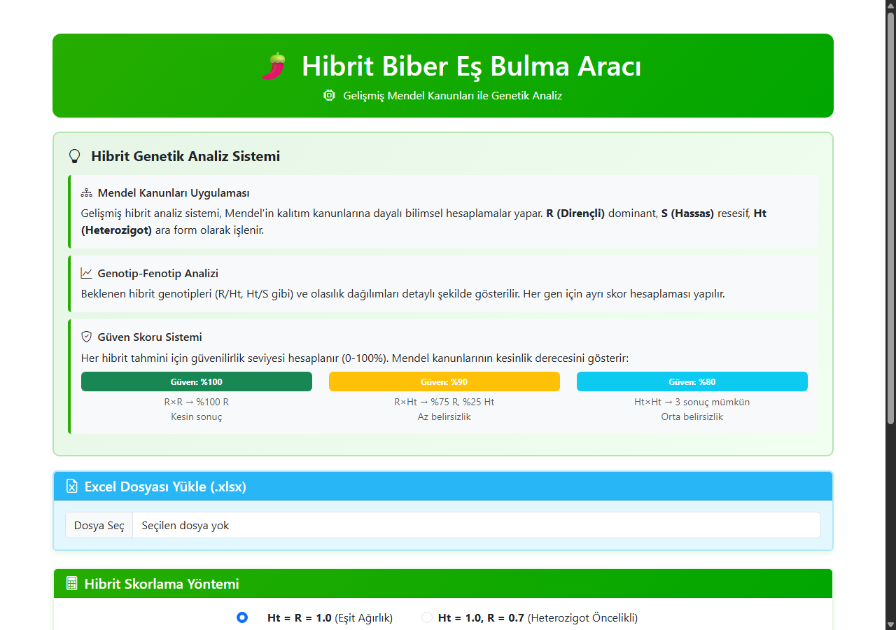
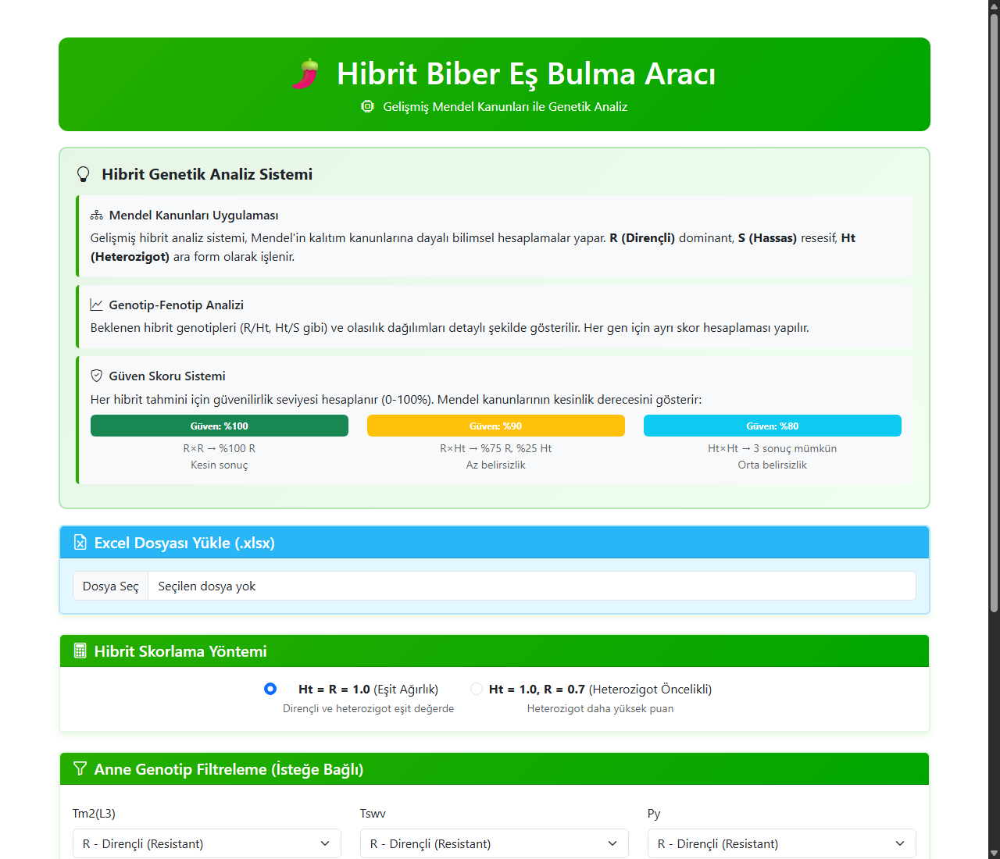
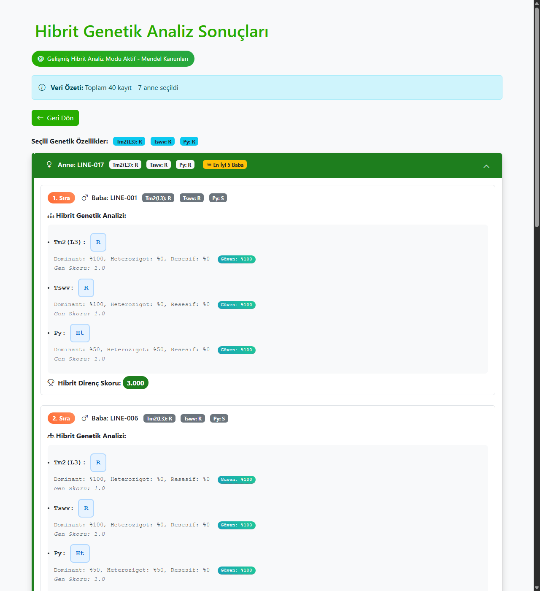

# Inheritance – Pepper Marker-Based Hybrid Resistance Analysis

A Flask web application that scores and ranks pepper (biber) parent combinations for hybrid breeding, based on molecular marker genotypes and Mendelian inheritance.

> **Status:** unfinished / prototype. Developed for a private project that was never completed.

## Features

- Upload an Excel (`.xlsx`) file with marker genotype data per line (e.g. `R`, `Ht`, `S`, `NT`)
- Select the female (mother) line and the marker columns for the crosses
- Predicts hybrid genotype and probabilities (dominant / heterozygous / recessive) for every parent pair using a Mendelian cross matrix
- Two scoring methods with different resistance weightings
- Vectorized scoring with pandas / numpy
- Results page and Excel export of ranked crosses

## Screenshots

Captured with the synthetic dataset in [sample_data.xlsx](sample_data.xlsx).

**1. Home / upload page**



**2. Marker filters for the mother lines**



**3. Ranked results (top 5 fathers per mother)**



## Project Structure

```
app.py                 # Flask app, genotype logic and scoring
templates/             # index.html (upload/config), results.html
sample_data.xlsx       # Synthetic demo dataset (random, not real data)
docs/                  # README screenshots
biber-es-bulma.ipynb   # Exploratory notebook (expects veri.xlsx)
requirements.txt
Dockerfile
```

## Run Locally

```bash
pip install -r requirements.txt
python app.py
```

Open http://localhost:5000.

## Run with Docker

```bash
docker build -t inheritance .
docker run -p 5000:5000 inheritance
```

## Input Data

The original dataset is not included. Try the app with the synthetic sample_data.xlsx, or provide your own Excel file whose first column is the line ID and whose other columns are marker genotypes (`R`, `Ht`, `S`, `NT`).

## Notes

- Change `app.secret_key` in `app.py` before any real deployment.
- The built-in Flask server is for development; use gunicorn or similar in production.
